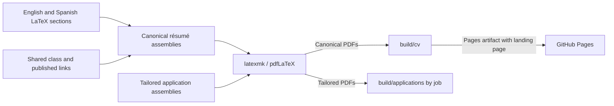

<!-- markdownlint-disable-next-line MD041 -->
<div align="center">

<h1>resume-maker</h1>

<p><strong>Build bilingual LaTeX résumés and keep the links you have already shared.</strong></p>

<p>
<a href="https://github.com/diegnghtmr/resume-maker/actions/workflows/publish.yml"></a>


<a href="LICENSE"></a>
</p>

<p>
<a href="https://diegnghtmr.me/en/work/resume-maker/"><strong>Case study</strong></a> &bull;
<a href="#quick-start"><strong>Quick start</strong></a> &bull;
<a href="#architecture"><strong>Architecture</strong></a>
</p>

</div>

A résumé link should still work after the PDF changes. This repository builds Diego Alejandro Flores Quintero's English and Spanish résumés from shared LaTeX sources, publishes the canonical set at stable paths, and keeps tailored applications out of the Pages build. A shorter main résumé links to separate education, work, and certification detail PDFs.

## Features

- **Canonical bilingual set.** Build one main résumé and three detail documents in each language.
- **Shared formatting and links.** Use the same LaTeX class and URL macros across all canonical targets.
- **Stable public URLs.** Replace the PDF at its existing path when the underlying content changes.
- **Separate application builds.** Compile job-specific copies under their own build directory so they do not overwrite canonical output.
- **Explicit publish targets.** Publish a reviewed target list and an index page rather than sweeping all local PDFs into Pages.

## Quick start

With Docker running, build through the TeX Live container; a local TeX install is not needed. The first build may need to pull the image, which is cached locally after that.

```sh
git clone https://github.com/diegnghtmr/resume-maker.git
cd resume-maker
scripts/build.sh
```

To build only one canonical PDF, run `scripts/build.sh cv/main-en.tex`. On Windows PowerShell use `./scripts/build.ps1` or `./scripts/build.ps1 cv/main-en.tex`. Open the generated files under `build/cv/`. With a native TeX Live setup, `latexmk cv/main-en.tex` builds the canonical target; do not use bare `latexmk` for application files because the default output directory is `build/cv/`.

| Variable | Purpose | Default |
| --- | --- | --- |
| `LATEX_IMAGE` | Override the image used by the local Docker build wrappers. | `texlive/texlive:latest` |

### Published PDFs

The [GitHub Pages index](https://diegnghtmr.github.io/resume-maker/) links the eight canonical PDFs. These paths are relative to that site:

| Document | English | Spanish |
| --- | --- | --- |
| Main résumé | `/cv/main-en.pdf` | `/cv/main-es.pdf` |
| Education detail | `/cv/education-en.pdf` | `/cv/educacion-es.pdf` |
| Work detail | `/cv/work-en.pdf` | `/cv/experiencia-es.pdf` |
| Certifications detail | `/cv/certifications-en.pdf` | `/cv/certificaciones-es.pdf` |

## Architecture

The files in `cv/` assemble short or full language-specific sections using a shared class. `latexmkrc` selects pdfLaTeX and configures TeX's source paths. The local wrappers mirror each source folder under `build/`; only canonical PDFs are staged by [Publish CVs](.github/workflows/publish.yml). The workflow substitutes its landing-page version from the latest reachable `v*` tag.



## Tech stack

| Layer | Technology |
| --- | --- |
| Documents | LaTeX, shared `fed-res` document class |
| Compilation | TeX Live, `latexmk`, pdfLaTeX |
| Local wrappers | Docker, Bash, PowerShell |
| Publication | GitHub Actions, GitHub Pages, static HTML |

## Quality

The Publish CVs workflow runs on `main`, `v*` tags, or manual dispatch. It compiles the eight named targets and packages `build/cv/` and `web/`; an absent or failed canonical build prevents deployment. It checks that the staged landing page contains the computed version badge. For local verification, use the build wrappers above. There is no separate automated test suite in this workflow.

## Project structure

```text
shared/                 Document class, published URL macros, and unused bibliography
content/en, content/es  Short and full sections in each language
cv/                     Eight canonical assembly files
applications/           Build-only, append-only job variants
web/                    Public index and static assets
scripts/                Docker build wrappers
```

## Documentation

- [System design](docs/system-design.md) covers the publishing strategy and privacy trade-offs. Pages is public: `robots.txt` and the landing page's `noindex` discourage indexing but are not access controls. Application source committed to a public repository is also public.
- [Application workflow](applications/README.md) explains how to tailor a résumé without replacing a canonical PDF. The [agent skill](.claude/skills/resume-maker/SKILL.md) drives generation, and the [LaTeX reference](docs/reference/latex-ieee/SKILL.md) is vendored.
- Edit the appropriate `content/<lang>/` section to update a résumé without changing its address. To add a public document, update its unique `cv/` target, the workflow's explicit `root_file` list, [shared URLs](shared/links.tex), and the [landing page](web/index.html) together. A version tag redeploys the canonical set. For a new fork, set the Pages source to **GitHub Actions** and update its URL macros and public index together.

## License

[MIT](LICENSE).
